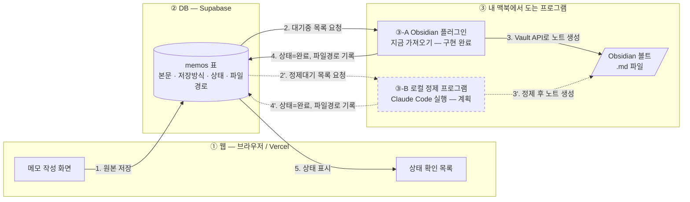
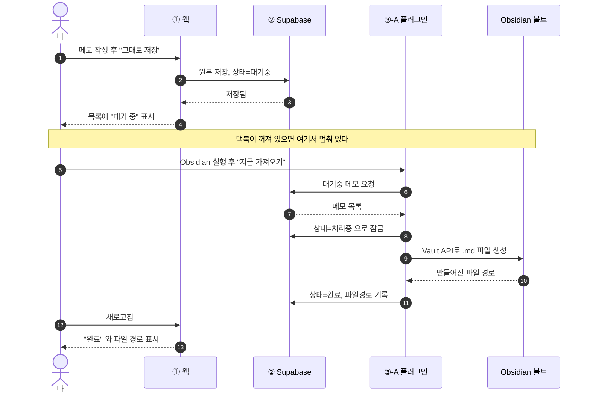
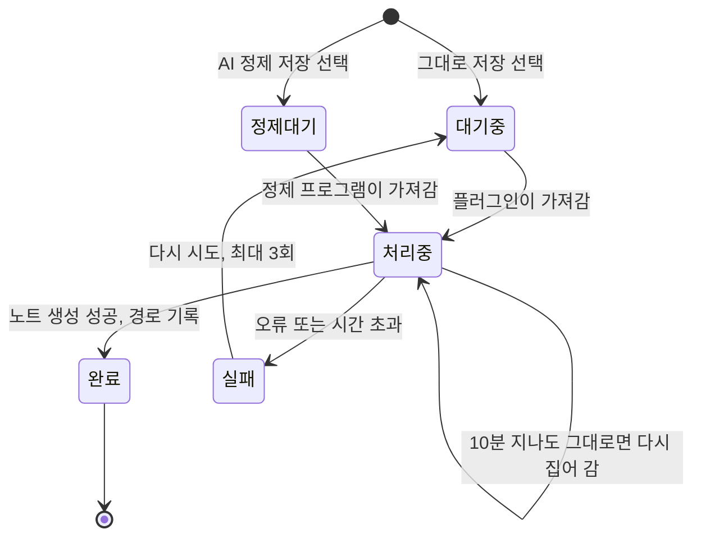

# docs/architecture.md — Personal Hub 설계 문서

**이 문서가 다루는 것**: 데이터가 어디서 어디로 흐르는지, 화면이 몇 개이고 주소가 무엇인지, 무엇을 저장하는지.
**이 문서가 다루지 않는 것**: 무엇을 만들고 무엇을 안 만들지(범위), 코드 규칙 → [CLAUDE.md](../CLAUDE.md)

---

## 1. 왜 세 부분으로 나눠야 하는가

**웹 브라우저는 내 컴퓨터의 볼트 폴더에 `.md` 파일을 만들 수 없다.**
브라우저가 임의 경로에 파일을 쓸 수 있으면 어떤 웹사이트든 남의 컴퓨터를 망칠 수 있으므로, 브라우저가 막아 놓은 것이다.
이 제약은 우회할 수 없다. 그래서 역할을 셋으로 나눈다.

| | 이름 | 어디서 도는가 | 이것만 한다 | 절대 안 하는 것 |
|---|---|---|---|---|
| ① | **웹** | Vercel, 브라우저 | 사람에게 입력받고 보여준다 | **파일을 만들지 않는다** |
| ② | **DB** | Supabase (클라우드) | 원본과 상태를 보관하는 **우편함** | 스스로 아무 일도 시작하지 않는다 |
| ③ | **내 컴퓨터 프로그램** | 내 맥북 | **볼트에 `.md` 파일을 만든다** | 화면을 대신 그리지 않는다 |

> **`.md` 파일을 만들 수 있는 것은 ③ 하나뿐이다.** 이 문장이 이 서비스 설계 전체의 출발점이다.

③은 다시 둘로 나뉜다.

| ③-A | **Obsidian 플러그인** | `지금 가져오기` 버튼 → 원문 그대로 노트 생성 | **구현 완료** |
|---|---|---|---|
| ③-B | **로컬 정제 프로그램** | 정제 대기 메모 → Claude Code 실행 → 제텔카스텐 노트 생성 | **아직 만들지 않음** |

②가 스스로 아무것도 시작하지 않는다는 점이 중요하다.
**언제나 ③이 ②에게 "나 줄 거 있어?"라고 물으러 간다.** ②가 ③을 부를 방법은 없다. 내 맥북에는 주소가 없기 때문이다.

---

## 2. 메모가 `.md` 파일이 되기까지 — 단계별 설명

### 2-1. 경로 A: 원문 그대로 저장 (지금 동작함)

**0단계 — 준비 (한 번만)**
설정 화면에서 저장할 볼트 안쪽 폴더 이름을 **직접 입력한다**(예: `0. Slip-box`).
**웹은 볼트 안을 볼 수 없으므로 폴더 목록을 드롭다운으로 고르게 하지 않는다.** 사람이 타이핑한 이름을 그대로 쓴다(→ 7절 결정 A).
볼트의 절대경로(`/Users/...`)는 저장하지 않는다. 플러그인은 이미 볼트 안에서 돌기 때문에 폴더 이름만 알면 된다.

**1단계 — 웹: 메모를 쓴다**
휴대폰이든 노트북이든 브라우저에서 본문과 해시태그를 쓰고 `Obsidian에 그대로 저장`을 누른다.

**2단계 — DB: 원본이 우편함에 놓인다**
웹이 Supabase `memos` 표에 한 줄을 넣는다. `저장방식 = 원문`, `상태 = 대기중`, `파일경로 = 비어 있음`.
**이 시점까지 볼트에는 아무 파일도 생기지 않았다.** 웹의 일은 여기서 끝난다.
화면에는 그 메모가 `대기 중`으로 보인다.

**3단계 — 맥북: 내가 Obsidian을 연다**
플러그인 설정에서 로그인해 두었으므로, 플러그인은 내 메모만 볼 수 있다.

**4단계 — 플러그인: `지금 가져오기`를 누른다**
플러그인이 DB에서 `저장방식 = 원문`이면서 다음 둘 중 하나에 해당하는 내 메모를 오래된 순서로 가져온다.
- `상태 = 대기중` 인 것
- **`상태 = 처리중`인데 `claimed_at`이 10분보다 오래된 것** — 지난번에 처리하다 맥북이 꺼진 메모다(→ 7절 결정 B)

가져온 메모를 **`상태 = 처리중`, `claimed_at = 지금`, `claimed_by = 기기 이름`으로 먼저 바꾼다** (같은 메모를 두 번 만들지 않기 위해).

**5단계 — 플러그인: 볼트에 `.md` 파일을 만든다**
Obsidian이 공식 제공하는 **Vault API**로 `0. Slip-box/2026-09-07 메모 12.md` 같은 파일을 만든다.
파일 맨 위에는 만들어진 시각, 해시태그, 메모 번호를 프론트매터로 넣는다.

**6단계 — 플러그인: DB에 결과를 되돌려 적는다**
`상태 = 완료`, `파일경로 = 0. Slip-box/2026-09-07 메모 12.md`, `처리시각`, `처리한 기기`를 기록한다.
**웹은 볼트 안을 들여다볼 수 없다. 그래서 "정말 만들어졌는지"를 아는 방법은 이 되돌려 적기 하나뿐이다.**

**7단계 — 웹: 결과가 보인다**
메모 목록의 상태가 `완료`로 바뀌고, 어느 파일이 되었는지 경로가 뜬다.

### 2-2. 경로 B: AI로 정제해 저장 (아직 만들지 않음)

1~2단계는 같다. 다만 `저장방식 = 정제`, `상태 = 정제대기`로 저장된다.

**3단계 — 맥북: 로컬 정제 프로그램이 실행된다**
Obsidian이 아니라, 맥북에서 도는 별도 프로그램이다.

**4단계 — 가져와서 잠근다**
`저장방식 = 정제`이고 `상태 = 정제대기`인 메모, 그리고 **`처리중`인 채 10분이 지난 메모**를 가져와 `상태 = 처리중`, `claimed_at = 지금`으로 바꾼다.

**5단계 — Claude Code와 정제 Skill을 실행한다**
프로그램이 직접 AI를 호출하지 않고, **맥북에 이미 깔려 있고 구독 계정으로 로그인된 Claude Code를 실행한다.**
그래서 API 키가 필요 없고 비용도 들지 않는다.

**6단계 — 기존 볼트에서 관련 노트를 먼저 찾는다**
정제하기 전에 볼트를 검색해 관련된 기존 노트를 찾는다.
**연결되지 않은 노트는 제텔카스텐이 아니라 그냥 파일 더미이기 때문이다.**

**7단계 — 하나의 핵심 생각을 담은 노트로 정제해 저장한다**
여러 생각이 섞인 원본을 핵심 하나짜리 노트로 다듬고, 6단계에서 찾은 노트로 가는 링크(`[[노트 제목]]`)를 넣어 볼트에 저장한다.

**8단계 — DB에 결과를 되돌려 적는다**
경로 A의 6단계와 같다. **웹에 쓴 원본 메모는 지우지 않고 그대로 남긴다** — 정제 결과가 마음에 안 들면 되돌려야 하기 때문이다.

### 2-3. 맥북이 꺼져 있을 때

- 웹은 **DB에 남기는 것으로 자기 할 일을 끝낸다.** 맥북 전원과 상관없이 메모는 언제든 쓸 수 있다.
- 맥북이 꺼져 있으면 3단계 이후가 진행되지 않고, 메모는 `대기중` / `정제대기` 상태로 DB에 남는다.
  **이건 실패가 아니라 정상 상태다.**
- 맥북을 켜고 Obsidian(A) 또는 정제 프로그램(B)을 실행하면 **밀려 있던 것부터 오래된 순서로 이어서 처리한다.**
- 이미 `완료`인 메모는 다시 가져오지 않는다. 파일 이름에 메모 번호가 들어가므로 중복도 막힌다.

---

## 3. 흐름 다이어그램

### 3-1. 전체 구조

점선은 아직 만들지 않은 부분이다.
**②에서 ③으로 가는 화살표는 모두 ③이 먼저 물어봐서 생기는 것이다. ②가 ③을 부르지는 못한다.**

### 3-2. 경로 A를 시간 순서로

### 3-3. 메모 하나의 상태 변화

---

## 4. IPO 표

### 4-1. 서비스 전체

| | 내용 |
|---|---|
| **입력(I)** | 메모(본문, 해시태그, 저장방식, 대상 폴더) / 일정(제목, 시작·종료 시각, 장소, 카테고리) / 할 일(제목, 마감, 카테고리, 하위 할 일) / 학업(시험 이름·날짜·과목별 공부 항목, 수행평가 제목·마감·준비 단계) / 계정(로그인, 볼트 폴더 지정) |
| **처리(P)** | 입력 검증(종료 시각이 시작보다 빠르면 거부) / 시각을 UTC로 저장하고 한국 시간으로 표시 / 할 일을 기한 지남·오늘·3일·7일로 분류 / 시험 D-Day와 남은 공부 항목 계산 / **메모를 대기 작업으로 큐에 쌓고, 맥북 프로그램이 가져가 노트로 만들고 상태를 되돌려 적음** / 과거 메모 재노출 점수 계산 |
| **출력(O)** | 오늘 브리핑, 달력(일·주·월), 할 일 목록, 학업 진도와 D-Day, 메모 처리 상태와 파일 경로 / **최종 결과물 = 볼트 안의 `.md` 노트 파일** |

### 4-2. 화면별

| 화면 | 입력 | 처리 | 출력 |
|---|---|---|---|
| 오늘 브리핑 | (없음, 읽기 전용) | 오늘 범위를 한국 시간 기준으로 계산, 기한 지난 할 일 분류, 재노출 점수가 낮은 메모 1개 고르기 | 오늘 일정, 임박 할 일, 시험 D-Day, 다시 보는 예전 메모 |
| 메모 | 본문, 해시태그, 저장방식, 대상 폴더(설정값이 기본으로 채워지고 직접 고쳐 쓸 수 있음) | 원본을 DB에 `대기중`/`정제대기`로 저장, 맥북 프로그램의 처리 결과 반영 | 최근 메모 목록, 상태 배지, 만들어진 파일 경로 |
| 일정 | 제목, 시작·종료, 장소, 카테고리, 빈 시간 드래그 | 시각 검증, UTC 저장 후 한국 시간 표시, 겹치는 일정 배치 | 일간·주간·월간 달력 |
| 할 일 | 제목, 마감, 카테고리, 하위 할 일, 체크 | 마감 기준 분류, 하위 할 일 진도 계산 | 오늘 / 예정 / 기한 초과 / 완료 |
| 학업 | 시험 이름·날짜·공부 항목, 수행평가 제목·마감·준비 단계 | D-Day와 남은 날짜, 과목별 진도율 계산 | 시험 진도 막대, 수행평가 월별 달력, D-DAY 준비 항목 |
| 설정 | 대상 볼트 폴더 **이름을 직접 입력**, 기기 등록 | 폴더 이름만 저장(절대경로는 저장 안 함), 앞뒤 공백과 맨 앞 `/` 제거 | 등록된 기기, 대기 중 작업 개수 |

---

## 5. 화면 목록과 라우트

React Router를 쓰고, Vercel에는 모든 경로를 `index.html`로 보내는 rewrite 설정을 넣는다(그러지 않으면 새로고침 시 404).

| 라우트 | 화면 | 파일 | 비고 |
|---|---|---|---|
| `/` | 오늘 브리핑 | `src/pages/Today.tsx` | 로그인 후 첫 화면 |
| `/memos` | 메모 관리 | `src/pages/Memos.tsx` | **핵심 화면** |
| `/calendar` | 일정 관리 | `src/pages/Calendar.tsx` | 보기 전환은 `?view=week` 같은 쿼리로 |
| `/todos` | 할 일 관리 | `src/pages/Todos.tsx` | |
| `/study/exams` | 학업 — 시험공부 | `src/pages/StudyExams.tsx` | `/study` 접근 시 여기로 보냄 |
| `/study/assignments` | 학업 — 수행평가·과제 | `src/pages/StudyAssignments.tsx` | |
| `/settings` | 설정 | `src/pages/Settings.tsx` | 볼트 폴더, 기기, 대기 작업 |
| `/login` | 로그인 | `src/pages/Login.tsx` | 유일하게 로그인 없이 열리는 화면 |

> 탭(일간/주간/월간, 시험/수행평가)을 쿼리나 하위 경로로 두는 이유: 주소를 그대로 즐겨찾기하면 같은 화면이 다시 열려야 하기 때문이다.

---

## 6. 저장할 데이터 (Supabase)

모든 표에 `id`, `user_id`, `created_at`, `updated_at`이 공통으로 들어가고,
**모든 표에 "본인 행만 읽고 쓸 수 있는" RLS 정책을 건다.**

### `profiles` — 계정 설정
| 열 | 형 | 설명 |
|---|---|---|
| `user_id` | uuid | 로그인 계정 |
| `default_vault_folder` | text | 볼트 **안쪽** 폴더 이름. 예: `0. Slip-box`. **사람이 설정 화면에서 직접 입력한 값**이다 |
| `timezone` | text | 기본 `Asia/Seoul` |

### `memos` — 메모이자 작업 큐 (가장 중요한 표)
| 열 | 형 | 설명 |
|---|---|---|
| `id` | bigint | 메모 번호. **파일 이름에 들어가 중복 생성을 막는다** |
| `content` | text | 웹에서 쓴 **원본**. 정제해도 지우지 않는다 |
| `tags` | text[] | 해시태그 |
| `save_mode` | text | `원문` \| `정제` |
| `status` | text | `대기중` \| `정제대기` \| `처리중` \| `완료` \| `실패` |
| `target_folder` | text | 저장할 볼트 안쪽 폴더. 저장 시점의 설정값을 그대로 복사해 둔다(나중에 설정을 바꿔도 이미 쓴 메모의 목적지가 흔들리지 않게) |
| `note_path` | text | 만들어진 파일 경로. **③이 되돌려 적는 칸** |
| `claimed_by` | text | 가져간 기기 이름 |
| `claimed_at` | timestamptz | 가져간 시각. **여기서 10분이 지났는데도 `처리중`이면 버려진 작업으로 보고 ③이 다시 집어 간다** |
| `error_message` | text | 실패 이유 |
| `retry_count` | int | 재시도 횟수, 최대 3 |
| `resurface_score` | int | 낮을수록 오늘 브리핑에 다시 나올 확률이 높다 |
| `last_shown_at` | timestamptz | 마지막으로 다시 보여준 시각 |

### `events` — 일정
`title`, `starts_at`(UTC), `ends_at`(UTC), `location`, `category`, `color`

### `todos` — 할 일 / `subtasks` — 하위 할 일
`title`, `due_at`, `category`, `is_done`, `done_at` / `todo_id`, `title`, `is_done`

### `exams` — 시험 / `exam_topics` — 과목별 공부 항목
`name`, `starts_on`, `ends_on` / `exam_id`, `subject`, `title`, `is_done`

### `assignments` — 수행평가 / `assignment_steps` — 준비 단계
`title`, `subject`, `due_at` / `assignment_id`, `title`, `is_done`

### `devices` — 내 컴퓨터 목록
`device_name`, `kind`(`플러그인` \| `정제프로그램`), `last_heartbeat_at`
→ 신호가 끊기면 웹에서 "AI로 정제하여 저장"을 고를 수 없게 막는 데 쓴다.

### 저장하지 않는 것
- **볼트 절대경로** (`/Users/이름/...`) — 개인정보가 들어가고, 서버에서 쓸 데도 없다.
- **AI API 키** — 애초에 쓰지 않는다. 맥북의 Claude Code를 실행할 뿐이다.
- 계산으로 나오는 값(D-Day, 진도율) — 두 벌로 저장하면 반드시 어긋난다.

---

## 7. 정한 것과, 아직 위험한 지점

`✅`는 검토 후 이렇게 하기로 **정한 것**이고, `⚠️`는 아직 대응하지 않은 **남은 위험**이다.

### ⚠️ 1. 플러그인에 관리자 키를 넣으면 안 된다
Supabase에는 RLS를 무시하는 `service_role` 키가 있다. 플러그인이 편하다고 이걸 쓰면 **키 하나로 전체 데이터가 열린다.**
→ 플러그인도 웹과 똑같이 **사용자 로그인**을 해서 anon 키 + RLS로 접근한다. `service_role` 키는 어디에도 넣지 않는다.

### ⚠️ 2. 노트는 만들어졌는데 DB 기록 직전에 프로그램이 죽으면
파일은 볼트에 있는데 상태는 `처리중`이다. 다시 가져오면 **같은 노트가 두 개 생긴다.**
→ 파일 이름을 **메모 번호로 정해 두고**(`2026-09-07 메모 12.md`), 만들기 전에 같은 이름이 있으면 새로 만들지 않고 상태만 `완료`로 바꾼다. 몇 번을 다시 돌려도 결과가 같아야 한다.

### ✅ 결정 A. 볼트 폴더는 목록에서 고르지 않고 **직접 입력한다**
메모 화면에서 대상 폴더를 *고르게* 하려면 폴더 목록이 필요한데, **웹은 볼트 안을 볼 수 없다.**
플러그인이 폴더 목록을 DB에 올려 주는 방법도 있지만, 그건 그 자체로 기능 하나다.
→ **설정 화면에서 폴더 이름을 사람이 직접 입력한다.** 메모 화면에는 그 값이 기본으로 채워지고, 필요하면 그 자리에서 고쳐 쓴다.
→ 저장할 때 앞뒤 공백과 맨 앞 `/`만 정리한다. **폴더가 실제로 있는지는 웹이 확인할 수 없다.**
→ 없는 폴더 이름이 들어오면 ③이 노트를 만들 때 그 폴더를 새로 만들거나, 만들 수 없으면 `실패`와 이유를 DB에 적는다.
> 근거: 폴더 목록 동기화는 웹·DB·플러그인 세 곳을 모두 고쳐야 하는 일이라, 핵심인 경로 A를 완성하기 전에 손댈 일이 아니다. 나중에 필요해지면 이 결정만 바꾸면 된다.

### ✅ 결정 B. `처리중`에 10분 이상 갇힌 메모는 다시 집어 간다
맥북이 처리 도중 꺼지면 그 메모는 `처리중`에 갇혀 아무도 다시 가져가지 않는다. 그대로 두면 **영영 노트가 되지 않는다.**
→ ③이 메모를 가져올 때의 조건에 **`상태 = 처리중`이고 `claimed_at`이 10분보다 오래된 것**을 함께 넣는다.
→ **되돌리는 일을 ②(DB)나 ①(웹)이 하지 않는다.** ②는 스스로 아무 일도 시작하지 못하고, ①은 처리에 관여하지 않기 때문이다. **가져가는 쪽이 직접 판단한다.**
→ 다시 집어 갈 때 `retry_count`를 1 올리고, **3을 넘으면 `실패`로 두고 더 시도하지 않는다.** 계속 실패하는 메모가 매번 큐를 막지 않게 하기 위해서다.
→ 10분으로 정한 이유: 노트 하나 만드는 데 몇 초면 충분하므로 10분이 지났다면 정상 처리 중일 가능성이 사실상 없다. 반대로 너무 짧으면 정상 작업을 남이 뺏어 갈 수 있다.
→ 이 규칙이 안전한 것은 **다시 만들어도 결과가 같기 때문**이다(위험 2번의 파일 이름 규칙). 그 규칙이 없으면 이 복구가 오히려 중복 노트를 만든다.

### ⚠️ 3. 이동 중에 인터넷이 없으면 메모 자체가 저장되지 않는다
"이동 중에 Obsidian을 못 쓴다"가 이 서비스를 만든 이유인데, 지하철에서 네트워크가 끊기면 **저장 버튼이 실패하고 쓴 글이 날아갈 수 있다.**
→ 최소한 저장 실패 시 입력한 글을 브라우저에 남겨 두고 다시 시도할 수 있게 한다. 완전한 오프라인 지원은 범위 밖이다.

### ⚠️ 4. 파일 이름에 쓸 수 없는 글자
메모 첫 줄을 제목으로 쓰면 `/ : \ ? * " < > |` 같은 글자에서 파일 만들기가 실패한다. 같은 제목이 두 번 나올 수도 있다.
→ 파일 이름은 **`날짜 + 메모 번호`로 고정**하고, 사람이 읽을 제목은 파일 안 프론트매터에 넣는다.

### ⚠️ 5. 웹에서 메모를 지워도 볼트의 노트는 남는다
흐름이 한 방향(`웹 → 볼트`)이라 삭제는 따라가지 않는다.
→ **이건 버그가 아니라 정한 규칙이다.** 노트를 지우는 일은 Obsidian에서 직접 한다. 웹의 삭제 버튼 옆에 그렇게 적어 둔다.

### ⚠️ 6. Claude Code 실행이 끝나지 않을 수 있다 (경로 B)
프로그램이 AI 실행을 기다리다 무한정 멈추면 메모가 `처리중`에 갇힌다.
→ **시간 제한을 걸고**, 넘으면 `실패`와 이유를 기록한다. 재시도는 3회까지만 한다.

### ⚠️ 7. 정제 결과가 원본보다 나쁠 수 있다
AI가 핵심을 잘못 골라 오히려 정보가 사라질 수 있다.
→ 원본은 DB에 그대로 남기고, **정제된 노트 안에도 원문을 접어서 함께 넣는다.**

### ⚠️ 8. 경로 B는 8차시 안에 끝나지 않는다
로컬 프로그램, Claude Code 실행, 볼트 검색, 정제 규칙까지 만들려면 한 차시로 부족하다.
→ **8차시까지는 경로 A를 완성하는 것이 목표**다. 경로 B는 그 뒤 과제로 둔다. 계획서에도 정제는 마지막 단계로 적혀 있다.
